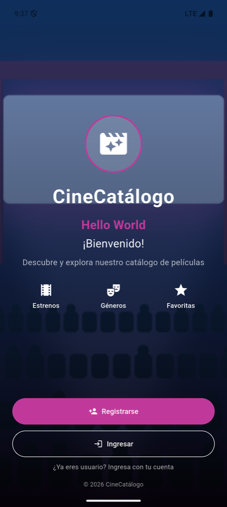

# LDSW_Layouts — CineCatálogo

Aplicación móvil de catálogo de películas desarrollada en Flutter. En esta actividad se edita la **pantalla de inicio (home screen)** siguiendo el procedimiento de *Layouts en Flutter*: muestra el **nombre de la aplicación**, un **mensaje de bienvenida** ("Hello World" / "¡Bienvenido!"), una **imagen de fondo** e **íconos**.

Continúa lo desarrollado en [LDSW_Widgets](https://github.com/tatiana1398/LDSW_Widgets): el botón **Ingresar** lleva a la pantalla de catálogo creada en esa actividad.

- **Participante:** Tatiana Montenegro Domínguez
- **Asignatura:** Programación Móvil
- **Asesor(a):** Gabriel Peralta Domínguez



## Cómo se construyó el layout

El código está en [`lib/screens/inicio_screen.dart`](lib/screens/inicio_screen.dart). Siguiendo el tutorial, primero se dividió la pantalla (pantalla 1 del wireframe) en capas y secciones, y cada sección se programó como un widget independiente:

```
Scaffold
└── Stack (capas)
    ├── Image.asset            ← imagen de fondo (assets/images/fondo_cine.jpg)
    ├── Container              ← capa oscura con degradado para leer el texto
    └── SafeArea > Column      ← contenido
        ├── SeccionLogo            Icon(movie_filter) dentro de un círculo
        ├── SeccionTitulo          Text: "CineCatálogo", "Hello World", "¡Bienvenido!"
        ├── SeccionCaracteristicas Row de columnas Icon + Text (Estrenos, Géneros, Favoritas)
        ├── SeccionBotones         Registrarse / Ingresar (con íconos)
        └── Text                   "© 2026 CineCatálogo"
```

| Widget | Uso en la pantalla de inicio |
|---|---|
| **Text** | Nombre de la app, "Hello World", "¡Bienvenido!", descripción, etiquetas y pie de página. |
| **Image** | `Image.asset` con `BoxFit.cover` como imagen de fondo de toda la pantalla. |
| **Icon** | Logo de la app, íconos de Estrenos, Géneros y Favoritas, e íconos de los botones. |
| **Stack** | Pone el contenido encima de la imagen de fondo. |
| **Row / Column** | Acomodan las secciones en vertical y los íconos en horizontal. |

La imagen de fondo está registrada en `pubspec.yaml`:

```yaml
flutter:
  assets:
    - assets/images/
```

## Estructura

```
lib/
├── main.dart                    # App, tema y colores; la pantalla inicial es InicioScreen
├── models/pelicula.dart         # Modelo Pelicula y datos de ejemplo
└── screens/
    ├── inicio_screen.dart       # Pantalla de inicio (esta actividad)
    └── catalogo_screen.dart     # Catálogo (actividad de widgets)
assets/images/fondo_cine.jpg     # Imagen de fondo
test/widget_test.dart            # Pruebas
```

## Cómo ejecutar

```bash
flutter pub get
flutter run          # en un emulador o dispositivo conectado
flutter test         # pruebas
flutter analyze      # análisis estático (sin errores)
```

### Material de apoyo

- [Layouts en Flutter](https://docs.flutter.dev/ui/layout)
- [Tutorial: construir un layout](https://docs.flutter.dev/ui/layout/tutorial)

Probado en el emulador Android Pixel 9 Pro XL (API 35) con Flutter 3.47.6 (Dart 3.13.5).
